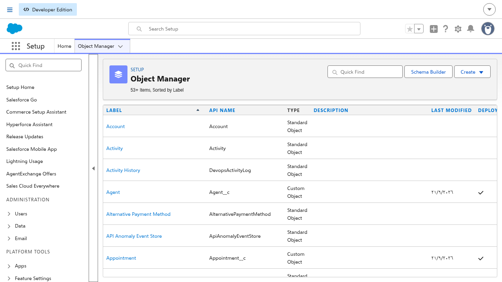
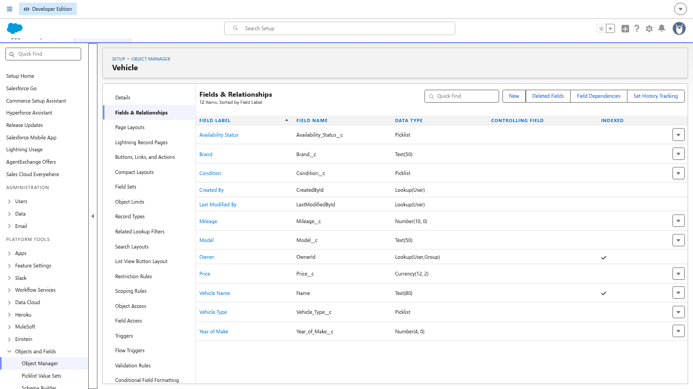
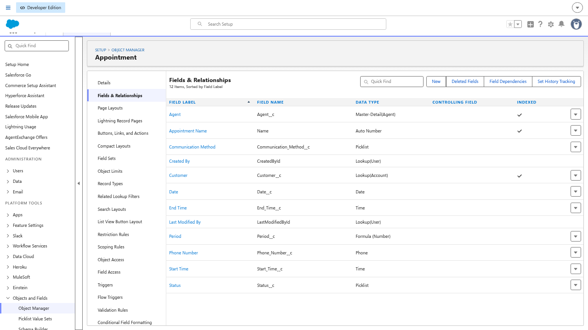
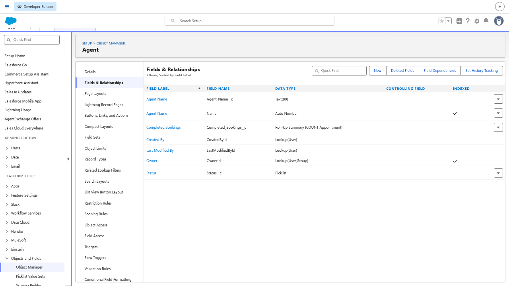
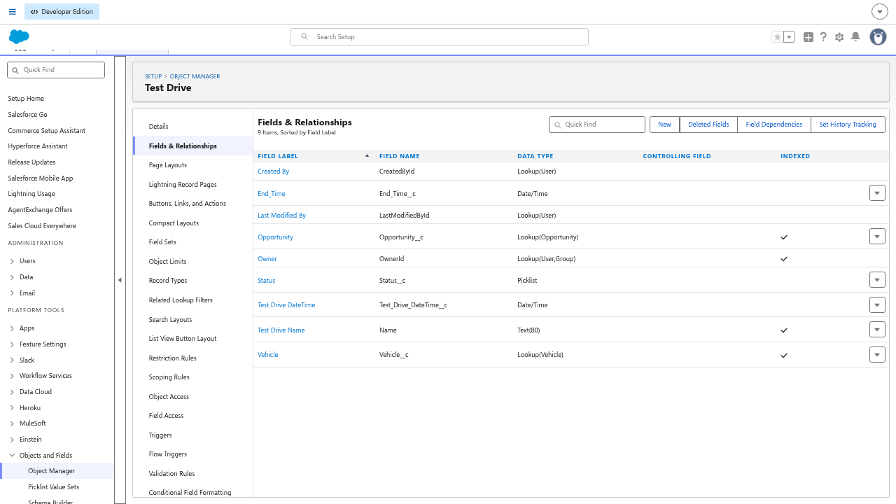
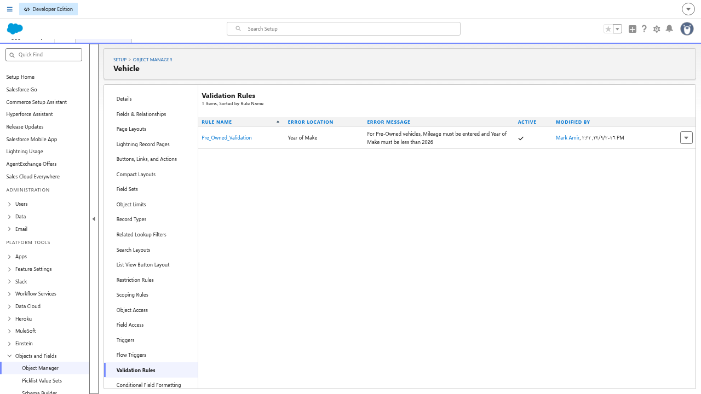
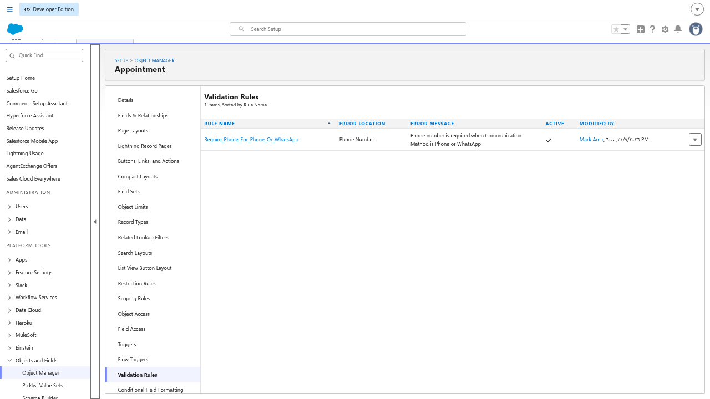
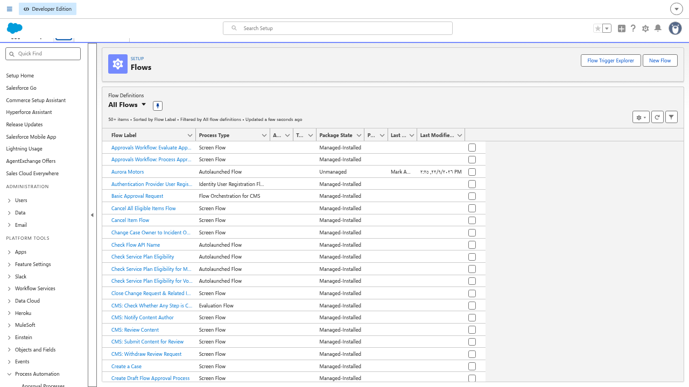
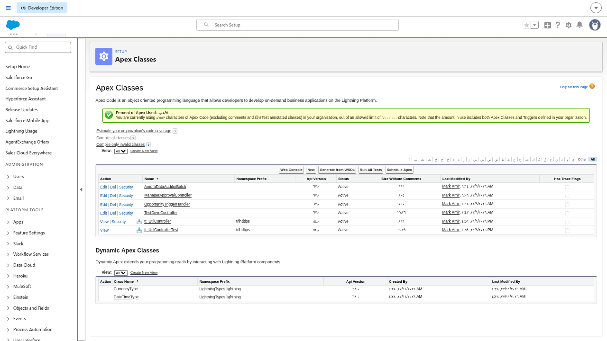
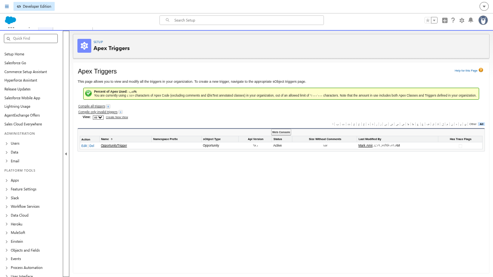

# Aurora Motors & Appointment Booking - Salesforce Projects

Two connected Salesforce applications built in one org: a car dealership sales app (Aurora Motors) and an appointment booking app. Built with a mix of declarative tools (custom objects, validation rules, Flow, reports and dashboards) and programmatic tools (Apex trigger, Apex classes, batch + schedulable Apex).

## Aurora Motors - car dealership sales

Manages vehicle inventory, test drives and the opportunity pipeline.

- **Vehicle catalog** (`Vehicle__c`): brand, model, type, condition, mileage, price, year of make, availability status.
- **Test drives** (`Test_Drive__c`): scheduled against a vehicle and an opportunity, with date/time and status.
- **Price automation**: a before insert/update trigger on Opportunity calculates the final price (vehicle price minus discount) and automatically routes any deal with a discount above 10% to "Pending Approval".
- **Manager approval**: a screen flow (`Manager_Approval_Flow`) backed by `ManagerApprovalController` lets a manager review pending deals and approve (Closed Won) or reject (back to Negotiating).
- **Data hygiene batch**: `AuroraDataAuditorBatch` (batch + schedulable) finds opportunities stuck in "Scheduled for Test Drive" past their close date and moves them back to "Negotiating".
- **Reporting**: sales pipeline and closed deals reports, plus an "Aurora Motors Sales & Inventory" dashboard.

## Appointment Booking

A booking app for agent appointments.

- **Agents** (`Agent__c`): name, status, and a roll-up summary field counting completed bookings.
- **Appointments** (`Appointment__c`): master-detail to Agent, lookup to Account (customer), date, start/end time, communication method, phone number, status, and a formula field for the period.
- **Data quality**: a validation rule requires a phone number whenever the communication method is Phone or WhatsApp.

## Data model

| Object | Key fields | Relationships |
| --- | --- | --- |
| Vehicle__c | Brand, Model, Vehicle Type, Condition, Mileage, Price, Year of Make, Availability Status | Referenced by Test_Drive__c (Lookup) |
| Test_Drive__c | Test Drive DateTime, End Time, Status | Lookup to Vehicle__c, Lookup to Opportunity |
| Agent__c | Agent Name, Status, Completed Bookings (Roll-Up Summary COUNT) | Master of Appointment__c |
| Appointment__c | Date, Start/End Time, Communication Method, Phone Number, Status, Period (Formula) | Master-Detail to Agent__c, Lookup to Account |

## Automation

- Validation rule on Vehicle: for Pre-Owned vehicles, mileage is required and year of make must be before 2026.
- Validation rule on Appointment: phone number required for Phone or WhatsApp communication.
- Flows: `Aurora Motors` (autolaunched), `Manager_Approval_Flow` (screen), `Schedule Test Drive Flow` (screen).

## Apex

| Artifact | Type | Purpose |
| --- | --- | --- |
| `OpportunityTrigger` + `OpportunityTriggerHandler` | Trigger + handler | Final price calculation; discounts over 10% go to Pending Approval |
| `ManagerApprovalController` | Apex class (AuraEnabled) | Backs the manager approval screen flow: fetch pending, approve, reject |
| `AuroraDataAuditorBatch` | Batch + Schedulable Apex | Resets overdue test-drive opportunities to Negotiating |
| `TestDriveController` | Apex class | Test drive support logic |

## Screenshots

### Object Manager

### Vehicle object - fields

### Appointment object - fields (Master-Detail to Agent)

### Agent object - roll-up summary

### Test Drive object - fields

### Validation rules

### Flows

### Apex classes and trigger

## Built with

Apex (triggers, controllers, batch + schedulable), Salesforce Flow, custom objects with master-detail and lookup relationships, roll-up summary fields, validation rules, reports and dashboards.
